### Per al client, utilitzarem Zorin OS 18 amb configuració de "xarxa NAT". El server tindrem la interfície per treballar amb "xarxa només-amb-amfitrió" i l'altra amb "xarxa NAT". Això ens permetrà que el client tingui accés a Internet i que el servidor pugui comunicar-se amb el client.

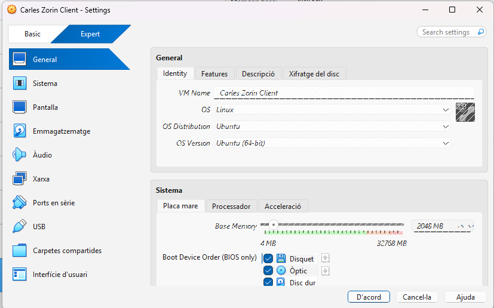

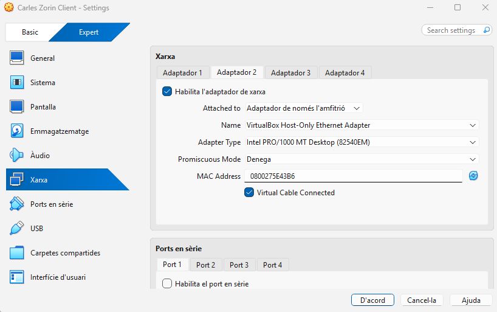

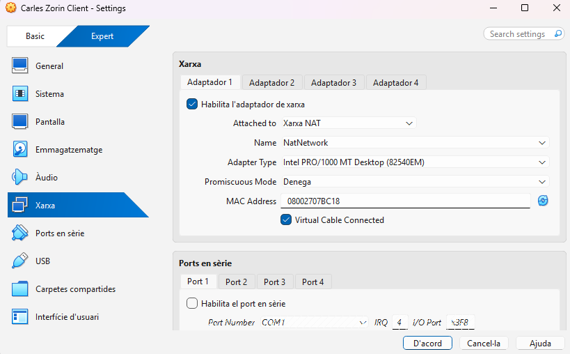

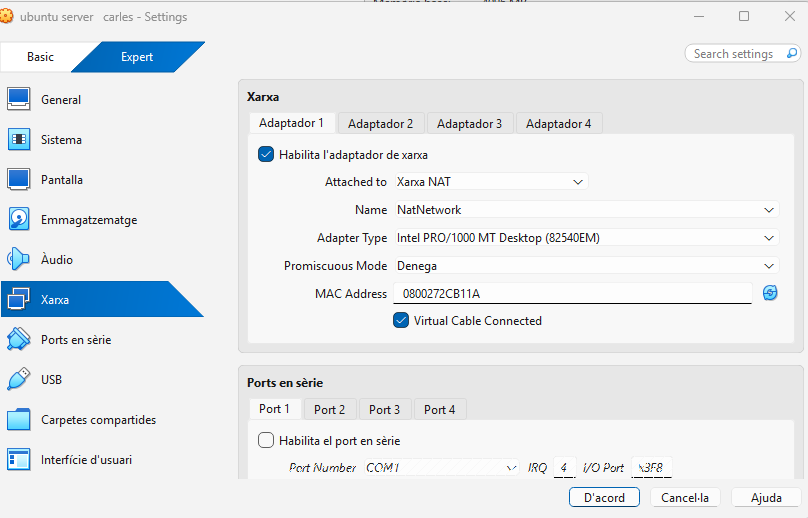

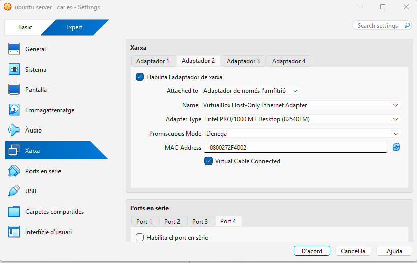

Poso de primer adaptador Xarxa NAT i de segon ADAPTADOR xarxa nomes amfitrio

### Fase 2: Preparació del servidor
### Abans de compartir res, hem de preparar els usuaris i els directoris al Servidor.

### Creació de Grups: Crear dos grups per al client: devs i admins.

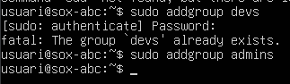

creo els grups que diu el enunciat
### Creació d'Usuaris: Crear un usuari dev01 (membre del grup devs).

### Crear un usuari admin01 (membre del grup admins).

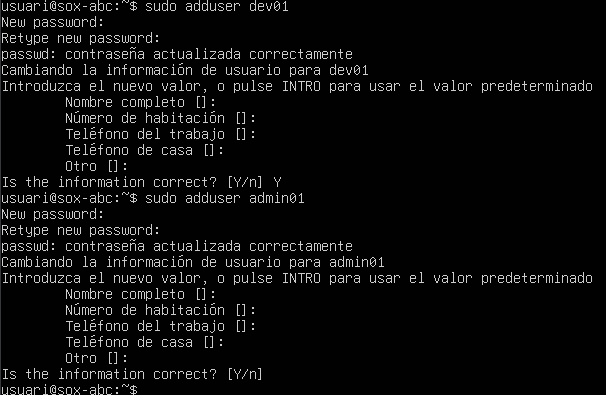

Creo el usuaris que hem demana
### Creació de Directoris (al Servidor):

### Crear el directori per als projectes de desenvolupament: /srv/nfs/dev_projects -Crear el directori per a les eines d'administració: /srv/nfs/admin_tools
### Permisos del Servidor (El punt clau):

creo els dos directoris que me has demanat
### Es vol que els developers tinguin control total sobre els seus projectes.

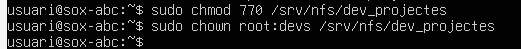

dono permisos de lectura, escriptura i execució al directori i asigno devs al directori
### Es vol que els administradors tinguin control sobre les seves eines.

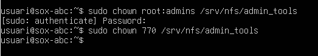

dono permisos de lectura, escriptura i execució al directori i asigno devs al directori
### En tots dos casos, l'usuari propietari serà root.

### Com a pas final, s'instal·laran els paquets necessaris per al servei NFS al servidor i es configurarà l'exportació dels directoris amb les opcions adequades.

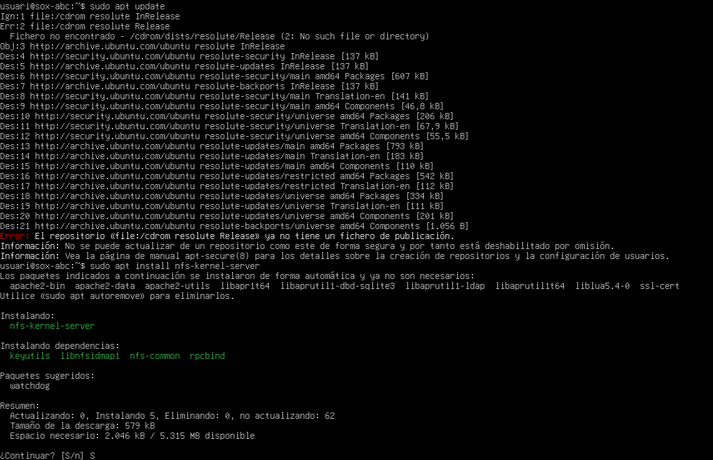
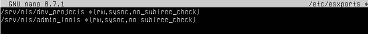
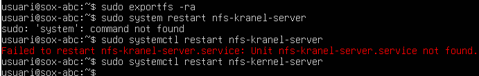

Instalo NFS obro el archiu de configuració i aplico la configuració

### Nota: Perquè aquesta pràctica funcioni correctament, heu de replicar aquests usuaris i grups al client, o, idealment, assegurar-vos que els UID i GID (els números d'identificació) coincideixin a les dues màquines.

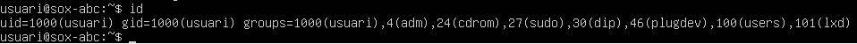
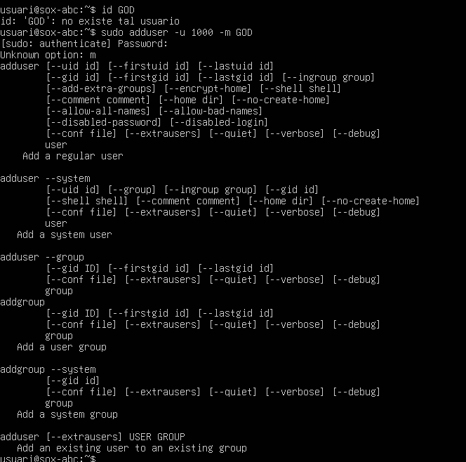

consulto els UID i GID, comprobo si existeix el usuari i el creo perque no existeix

## FASE 3

## El client necessita que el directori /srv/nfs/admin_tools sigui accessible per l'equip d'administradors. A vegades, l'usuari root del client (que sou vosaltres, els consultors) necessitarà escriure en aquest directori per instal·lar eines. Aquí mostrarem un error típic i la seva solució.

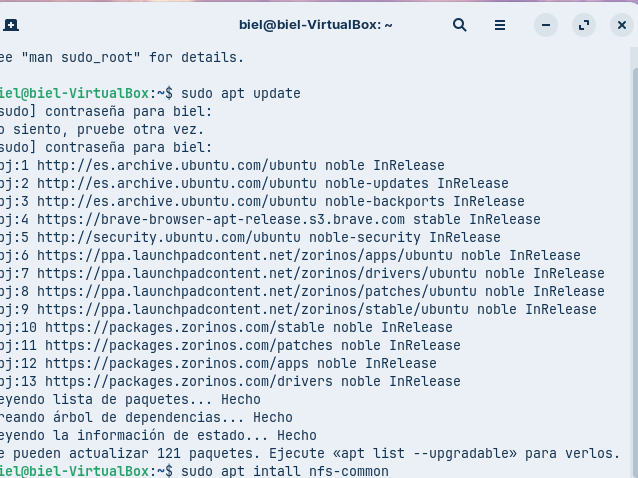

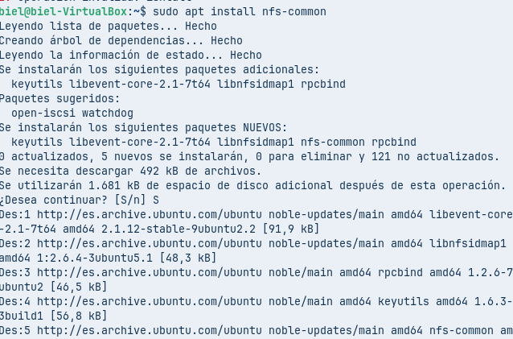

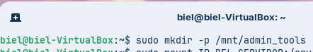

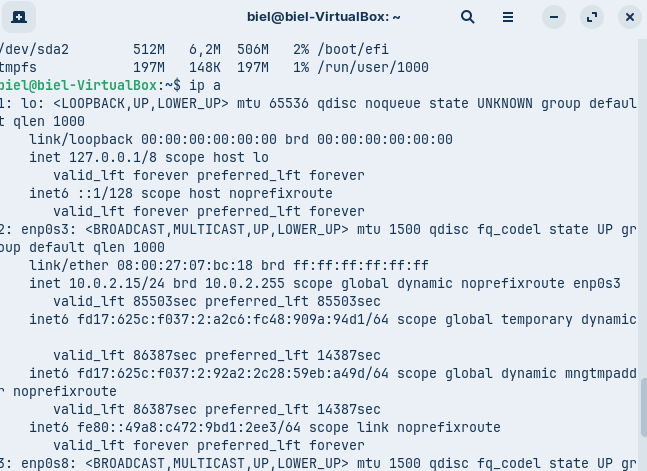

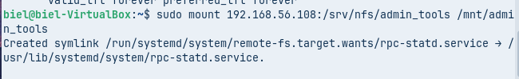

Instalo amb les einas del client NFS, Creo el directori on muntare la carpeta compartida, busco la ip i Montu el directori compartit del servido,

## Prova 1 (L'error comú)
## Exportar el directori /srv/nfs/admin_tools amb les opcions 'rw,sync'.

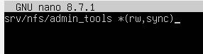

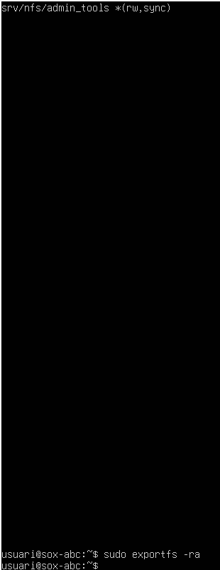

Primer he entrat a la màquina virtual servidor i he obert el fitxer de configuració d'exports de NFS i després he afegit aquesta línia per compartir el directori /srv/nfs/admin_tools amb permisos de lectura i escriptura i despres he aplicat els canvis

## Des del client, muntar aquest recurs compartit a /mnt/admin_tools. Com a root del client, intentar crear un fitxer dins d'aquest directori muntat.

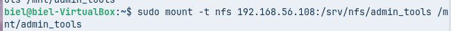

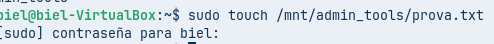

Primer he entrat a la màquina virtual client i he muntat el directori compartit del servidor a /mnt/admin_tools i després, he intentat crear un fitxer dins del directori muntat utilitzant l'usuari root del client:

## Verificar quin és el propietari del fitxer creat. Per què? Justificar la resposta amb l'explicació tècnica de 'root_squash'.

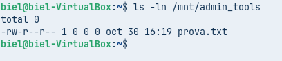

He comprovat el propietari del fitxer prova.txt amb la comanda ls -ln /mnt/admin_tools. El resultat mostra que el propietari té UID 0 i el grup té GID 0, és a dir, apareix com a root:root.

Això no és el resultat esperat si root_squash està activat, ja que aquesta opció transforma les peticions de l'usuari root del client en un usuari anònim, normalment amb UID 65534.

## Prova 2 (La Solució)
## Modificar l'exportació del directori /srv/nfs/admin_tools per incloure l'opció 'no_root_squash'.

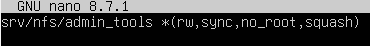

He entrat a la màquina virtual servidor i he obert el fitxer de configuració, he modificat la línia del directori admin_tools i he aplicat la nova configuració

## Al client, desmuntar i tornar a muntar el recurs compartit.

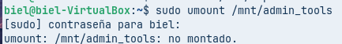

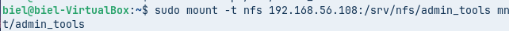

He entrat a la maquina virtual del client desmuntar el recurs compartit i tornar a muntar el recurs compartit

## Com a root del client, intentar crear un fitxer dins d'aquest directori muntat. Observeu quin és el propietari del fitxer creat aquesta vegada. Ha canviat alguna cosa? Justificar la resposta amb l'explicació tècnica de 'no_root_squash'.

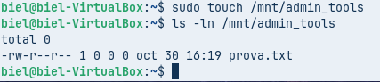

he intentat crear un fitxer dins del directori compartit com a usuari root i Després he comprovat qui és el propietari del fitxer

# Fase 4: L'Exportació de Desenvolupament (Permisos rw vs ro)
## Editar /etc/exports per afegir dues exportacions per al mateix directori. El client vol que la xarxa d'administració (p.ex., 192.168.56.0/24) hi pugui escriure, però que la xarxa de consultors (simularem que és una altra IP, p.ex., 192.168.56.150) només pugui llegir.

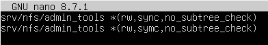

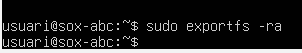

He entrat a la màquina virtual servidor i he obert el fitxer de configuració, he afegit aquestes dues línies al fitxer i he aplicat la nova configuració

## Si les dues màquines es veuen per xarxa NAT, useu una IP consistent amb el rang de la xarxa NAT. Per exemple, per exemple, 10.0.2.100.

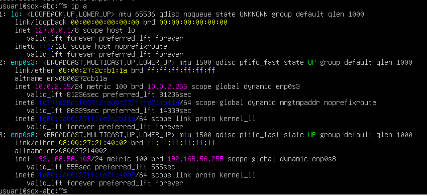

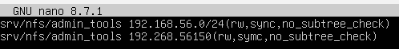

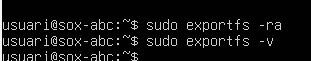

He entrat a la configuaracio i he adaptat la lineas al que hem demana el exercici i he aplicat els canvis

## Des del client, muntar el recurs compartit a /mnt/dev_projects i provar d'escriure-hi com a usuari dev01. Hauria de funcionar.

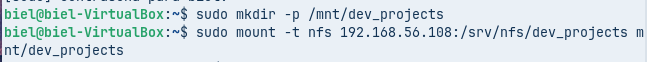

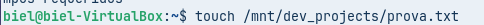

Creo el directorio, monto la carpeta compartida, cambio al usuario dev01 i probo si puedes escribir

## Desmuntar el recurs i canviar manualment la IP del client a 192.168.56.100. Tornar a provar d'escriure al directori muntat com a usuari dev01 i comprovar que només funciona la lectura.

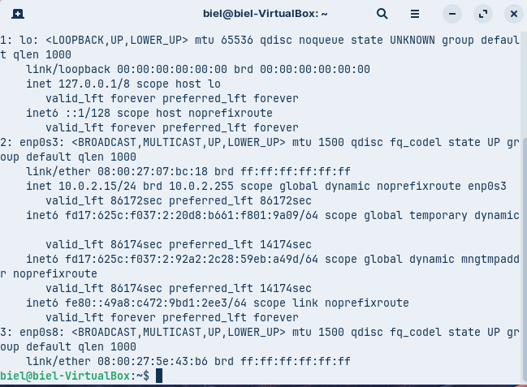

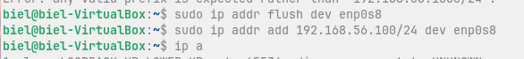

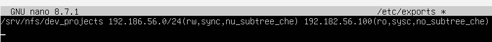

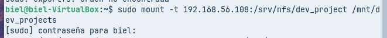

Primer he desmuntat el recurs compartit NFS des de la màquina virtual client, després he canviat manualment la IP del client a 192.168.56.100, he comprovat que la IP s'havia canviat correctament amb, a continuació, he tornat a muntar el recurs compartit, finalment, he intentat crear un fitxer com a usuari dev01.

## Canvieu d'usuari al client a admin01 i torneu a provar d'escriure al directori muntat. Comproveu que no es pot escriure, ja que admin01 no és membre del grup devs (permisos locals del sistema de fitxers).

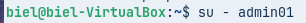

Primer he canviat a l'usuari admin01 des de la màquina virtual client, després he intentat crear un fitxer dins del directori compartit i he comprovat el contingut del directori

## Fase 5: Muntatge Automàtic amb /etc/fstab

## Editar el fitxer /etc/fstab al client per afegir les entrades necessàries per muntar automàticament els recursos compartits NFS al directori /mnt/admin_tools i /mnt/dev_projects durant l'inici del sistema.

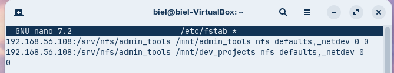

he obert el fitxer /etc/fstab i he afegit aquestes dues línies al final del fitxer

## Executar la comanda mount -a per provar les entrades sense reiniciar.

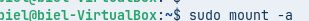

He executat la comanda següent al client per comprovar les entrades del fitxer /etc/fstab sense haver de reiniciar la màquina virtual

## Reiniciar el client i verificar que els recursos compartits s'han muntat correctament.

He reiniciat la màquina virtual client amb la comanda següent