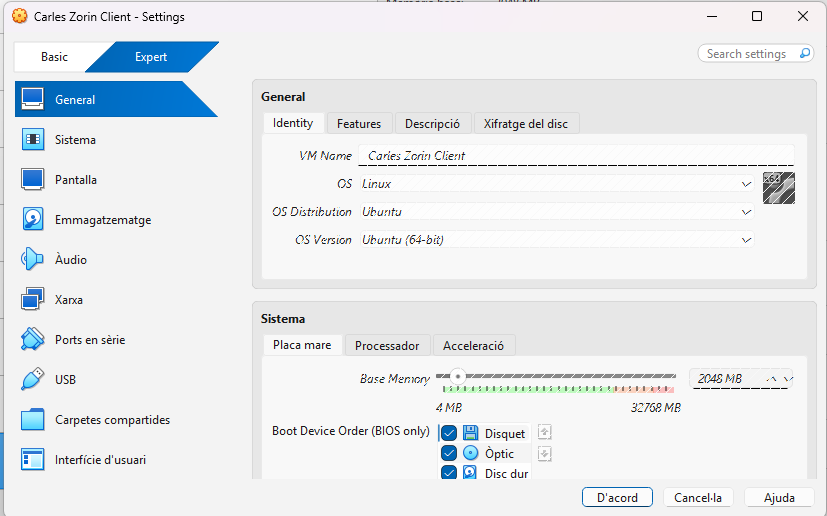
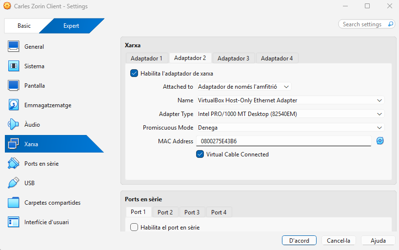
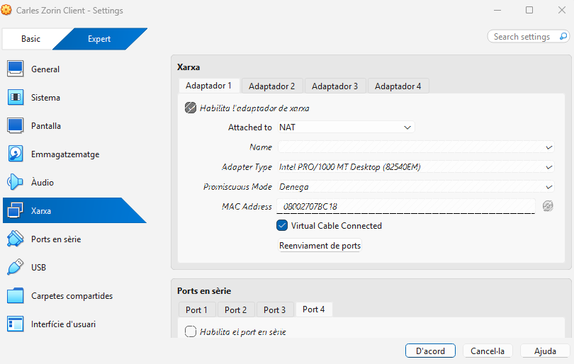
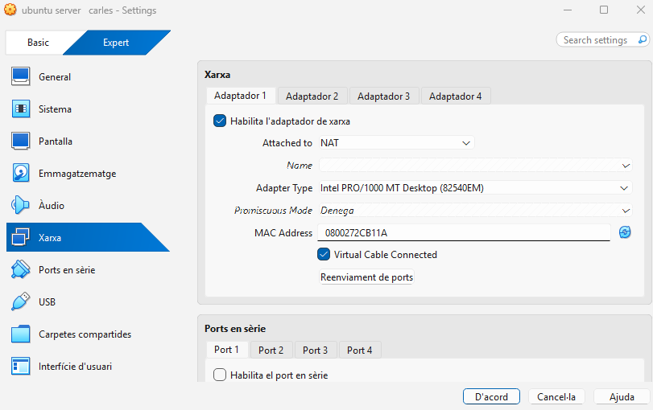
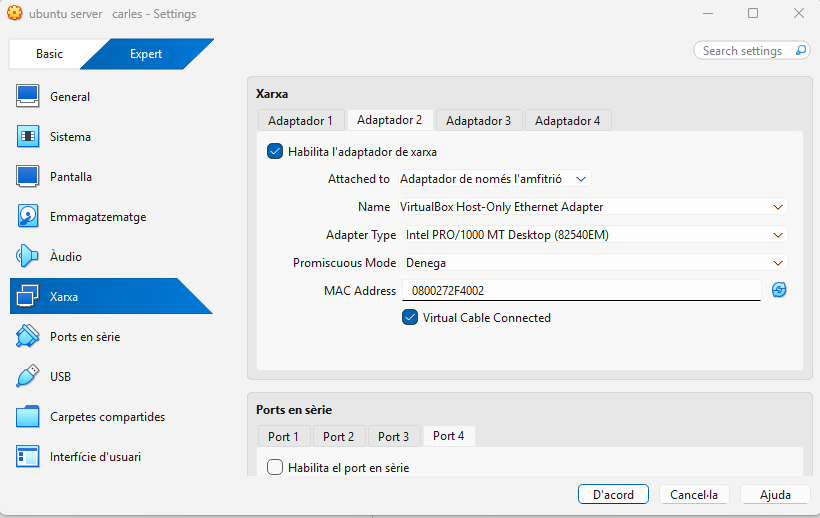
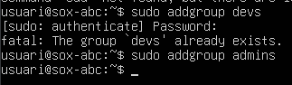
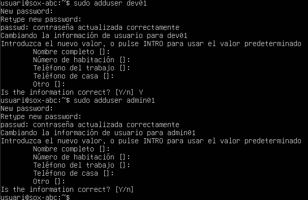
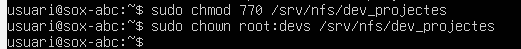

### Per al client, utilitzarem Zorin OS 18 amb configuració de "xarxa NAT". El server tindrem la interfície per treballar amb "xarxa només-amb-amfitrió" i l'altra amb "xarxa NAT". Això ens permetrà que el client tingui accés a Internet i que el servidor pugui comunicar-se amb el client.

Poso de primer adaptador NAT i de segon ADAPTADOR xarxa nomes amfitrio

### Fase 2: Preparació del servidor
### Abans de compartir res, hem de preparar els usuaris i els directoris al Servidor.

### Creació de Grups: Crear dos grups per al client: devs i admins.

creo els grups que diu el enunciat
### Creació d'Usuaris: Crear un usuari dev01 (membre del grup devs).

### Crear un usuari admin01 (membre del grup admins).

Creo el usuaris que hem demana
### Creació de Directoris (al Servidor):

### Crear el directori per als projectes de desenvolupament: /srv/nfs/dev_projects -Crear el directori per a les eines d'administració: /srv/nfs/admin_tools
### Permisos del Servidor (El punt clau):

creo els dos directoris que me has demanat
### Es vol que els developers tinguin control total sobre els seus projectes.

dono permisos de lectura, escriptura i execució al directori i asigno devs al directori
### Es vol que els administradors tinguin control sobre les seves eines.
### En tots dos casos, l'usuari propietari serà root.
### Com a pas final, s'instal·laran els paquets necessaris per al servei NFS al servidor i es configurarà l'exportació dels directoris amb les opcions adequades.

### Nota: Perquè aquesta pràctica funcioni correctament, heu de replicar aquests usuaris i grups al client, o, idealment, assegurar-vos que els UID i GID (els números d'identificació) coincideixin a les dues màquines.