### Per al client, utilitzarem Zorin OS 18 amb configuració de "xarxa NAT". El server tindrem la interfície per treballar amb "xarxa només-amb-amfitrió" i l'altra amb "xarxa NAT". Això ens permetrà que el client tingui accés a Internet i que el servidor pugui comunicar-se amb el client.

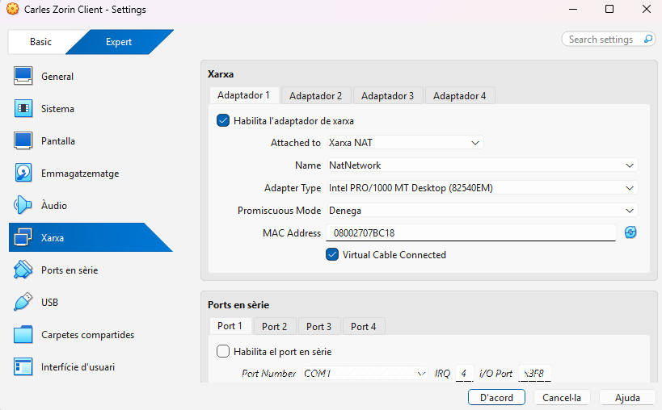

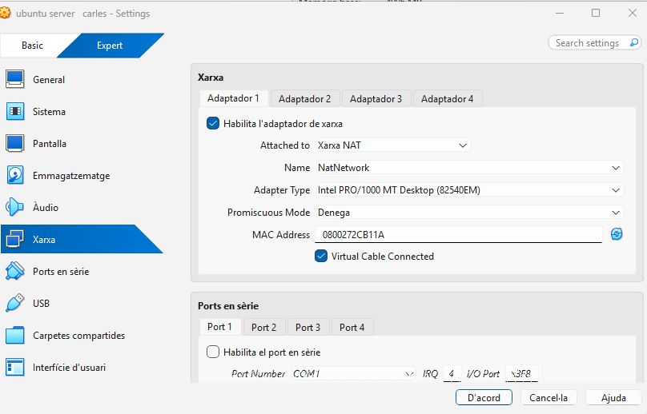

Poso de primer adaptador Xarxa NAT i de segon ADAPTADOR xarxa nomes amfitrio

### Fase 2: Preparació del servidor
### Abans de compartir res, hem de preparar els usuaris i els directoris al Servidor.

### Creació de Grups: Crear dos grups per al client: devs i admins.

creo els grups que diu el enunciat
### Creació d'Usuaris: Crear un usuari dev01 (membre del grup devs).

### Crear un usuari admin01 (membre del grup admins).

Creo el usuaris que hem demana
### Creació de Directoris (al Servidor):

### Crear el directori per als projectes de desenvolupament: /srv/nfs/dev_projects -Crear el directori per a les eines d'administració: /srv/nfs/admin_tools
### Permisos del Servidor (El punt clau):

creo els dos directoris que me has demanat
### Es vol que els developers tinguin control total sobre els seus projectes.

dono permisos de lectura, escriptura i execució al directori i asigno devs al directori
### Es vol que els administradors tinguin control sobre les seves eines.
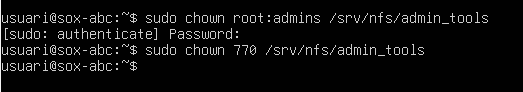

dono permisos de lectura, escriptura i execució al directori i asigno devs al directori
### En tots dos casos, l'usuari propietari serà root.

### Com a pas final, s'instal·laran els paquets necessaris per al servei NFS al servidor i es configurarà l'exportació dels directoris amb les opcions adequades.
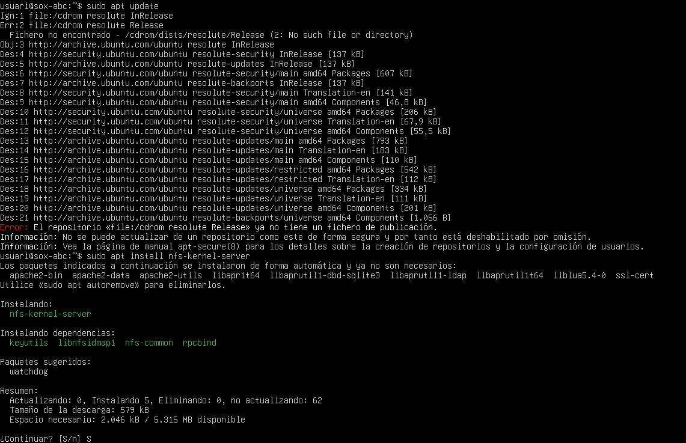
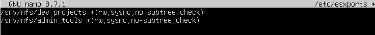
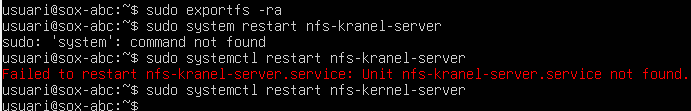

Instalo NFS obro el archiu de configuració i aplico la configuració

### Nota: Perquè aquesta pràctica funcioni correctament, heu de replicar aquests usuaris i grups al client, o, idealment, assegurar-vos que els UID i GID (els números d'identificació) coincideixin a les dues màquines.

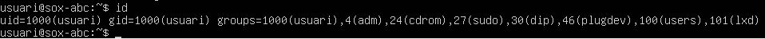
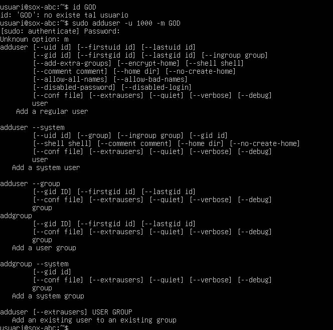

consulto els UID i GID, comprobo si existeix el usuari i el creo perque no existeix

## FASE 3

## El client necessita que el directori /srv/nfs/admin_tools sigui accessible per l'equip d'administradors. A vegades, l'usuari root del client (que sou vosaltres, els consultors) necessitarà escriure en aquest directori per instal·lar eines. Aquí mostrarem un error típic i la seva solució.
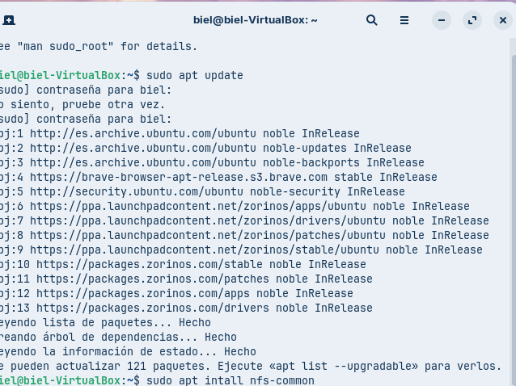
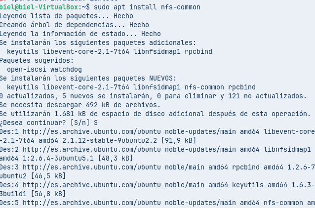
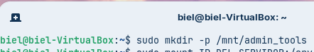
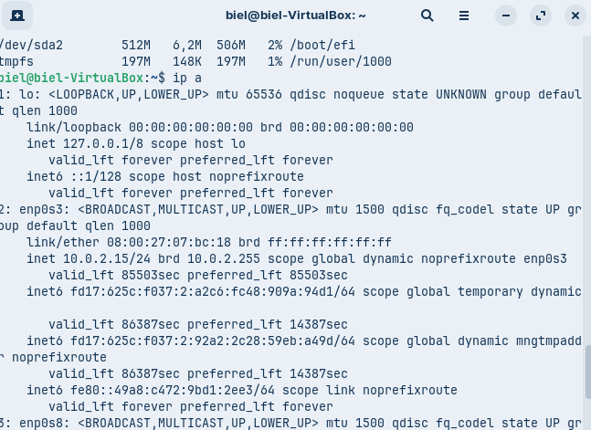
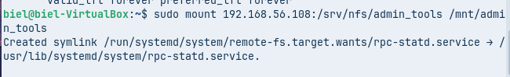

Instalo amb les einas del client NFS, Creo el directori on muntare la carpeta compartida, busco la ip i Montu el directori compartit del servido,

## Prova 1 (L'error comú)
## Exportar el directori /srv/nfs/admin_tools amb les opcions 'rw,sync'.
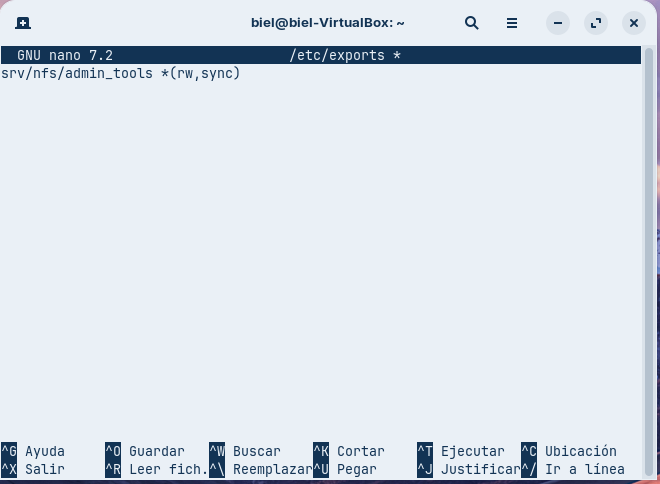
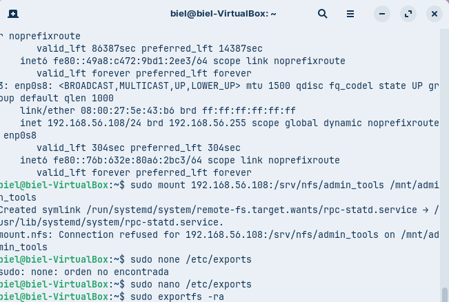

## Des del client, muntar aquest recurs compartit a /mnt/admin_tools. Com a root del client, intentar crear un fitxer dins d'aquest directori muntat.

## Verificar quin és el propietari del fitxer creat. Per què? Justificar la resposta amb l'explicació tècnica de 'root_squash'.

## Prova 2 (La Solució)
## Modificar l'exportació del directori /srv/nfs/admin_tools per incloure l'opció 'no_root_squash'.

### Al client, desmuntar i tornar a muntar el recurs compartit.

### Com a root del client, intentar crear un fitxer dins d'aquest directori muntat. Observeu quin és el propietari del fitxer creat aquesta vegada. Ha canviat alguna cosa? Justificar la resposta amb l'explicació tècnica de 'no_root_squash'.